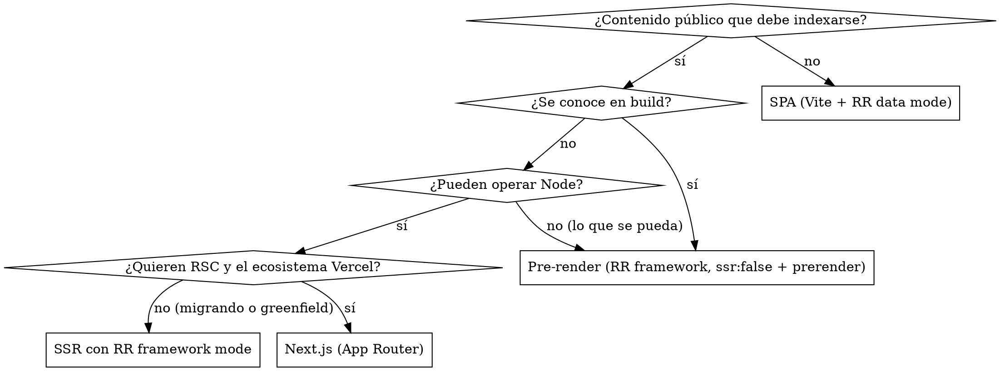

# SSR vs SPA: guía de decisión técnica

SSR no es "más moderno": es **un servidor más que operar** a cambio de HTML útil en la primera respuesta. Se elige por requisitos medibles (SEO, LCP, previews sociales) y no por moda. La decisión se registra (en un ADR o en cualquier documento de decisiones versionado).

## Contexto y reglas

Opciones (de menor a mayor costo operativo):

| Opción | Qué entrega | Infra | Encaja con |
|---|---|---|---|
| **SPA** (Vite + React Router *data mode*) | HTML vacío + JS; datos vía API | estáticos (CDN/nginx) | apps detrás de login, dashboards, backoffice; backend separado (FastAPI) |
| **SPA + pre-render** (RR *framework mode* con `ssr: false` + `prerender`) | HTML estático en build para rutas públicas conocidas | estáticos | landing/pricing/docs + app privada en el mismo repo |
| **SSR** (RR *framework mode* con `ssr: true`) | HTML por request con datos; loaders en servidor | Node (contenedor/serverless) | contenido público dinámico + SEO, migrando desde una SPA con React Router |
| **Next.js** (App Router, RSC) | SSR/streaming/RSC, caché granular | Node / Vercel | greenfield con contenido público grande (e-commerce, media), equipo dispuesto a adoptar RSC |

"Remix" para React es hoy React Router en **framework mode**: Remix v2 se fusionó en React Router v7. Una SPA hecha con loaders/actions de React Router (ver `routing-with-react-router`) migra a framework mode **sin rehacer el diseño de rutas**, pero cada módulo se adapta (`loader` pasa a `clientLoader`, `Component` a `export default`, `useLoaderData` a `loaderData`; ver los ejemplos): es el camino de menor costo hacia SSR.

**Default de este stack: SPA con Vite + React Router data mode.** Es lo que asumen `routing-with-react-router`, `architecting-react-apps`, `building-axios-clients` y el Dockerfile del frontend de `scaffolding-fastapi-backends` (`references/docker.md`, que sirve `dist/`). Se pasa a framework mode (pre-render o SSR) solo cuando hay contenido **público que debe indexarse** o previews sociales; la matriz dice cuál.

Matriz de decisión:

| Pregunta | Sí → | No → |
|---|---|---|
| ¿Las páginas que importan son públicas y necesitan indexarse o previews sociales? | pre-render o SSR | SPA |
| ¿Ese contenido se conoce en build (marketing, docs, catálogo chico)? | pre-render (sin servidor) | SSR |
| ¿LCP p75 en mobile > 2.5 s por culpa del JS (no del backend)? | SSR/streaming ayuda | optimizar bundle/API antes |
| ¿Toda la app está detrás de login? | SPA | (seguir evaluando) |
| ¿El equipo puede operar un runtime Node en producción (logs, escalado, cold starts)? | SSR viable | SPA o pre-render |
| Si hace falta pre-render o SSR: ¿ya usan React Router con loaders/actions? | RR framework mode (migración de menor costo) | RR framework mode igual, salvo que quieran RSC (fila siguiente) |
| ¿Quieren RSC, caché por componente y el ecosistema Vercel? | Next.js | RR framework mode |



**Hacer**

- Medir antes de decidir: Lighthouse/PageSpeed (LCP, INP, CLS en mobile, p75 de RUM si existe), Search Console (páginas no indexadas), tamaño del bundle inicial.
- Agotar primero las optimizaciones de SPA cuando el problema es rendimiento: code-splitting por ruta, loaders en paralelo, imágenes, caché HTTP de la API.
- Separar **sitio público** (pre-render/SSR) de **app privada** (SPA) cuando conviven: requisitos opuestos.
- Con SSR, mantener el backend FastAPI como fuente de verdad. Los loaders de servidor son un proxy delgado de **contenido público** (sin sesión), no un segundo backend con reglas de negocio. Esta biblioteca **no cubre SSR autenticado**: la cookie de refresh solo viaja a `/api/v1/auth` y los endpoints protegidos leen `Authorization: Bearer` que vive en memoria del navegador, así que un loader de servidor no puede actuar en nombre de la persona. Lo privado queda en la SPA.
- Registrar la decisión: contexto, opción elegida, costo operativo aceptado. Con **métricas** si la decisión se toma por rendimiento o SEO. Si **todo el producto está detrás de login**, la matriz ya lo resuelve (SPA) sin medir nada: alcanza con registrar ese motivo. El registro puede vivir en un ADR o en cualquier documento de decisiones versionado en el repo.
- Si la elección involucra Vercel (Next.js, Edge, despliegue), cargar las skills oficiales correspondientes desde `vercel-index`.

**Evitar (anti-patrones)**

| Anti-patrón | Consecuencia | En su lugar |
|---|---|---|
| Migrar a Next.js "porque sí" | reescritura, servidor nuevo y problemas reales sin resolver | matriz + métricas |
| SSR para un dashboard detrás de login | costo de servidor sin beneficio de SEO | SPA |
| Lógica de negocio duplicada en loaders de servidor y en FastAPI | dos fuentes de verdad | loader = proxy delgado a la API |
| Acceder a `window`/`localStorage` durante el render en SSR/pre-render | errores de hidratación o crash en build | efectos o `clientLoader` |
| Esperar que un loader de servidor renderice datos del usuario | la cookie no llega a la API (solo viaja a `/auth`) y el SSR sale anónimo | contenido público en SSR; la app privada sigue en SPA (o diseñar antes una sesión de servidor, fuera de esta biblioteca) |
| SSR sin caché ni límites | TTFB alto, servidor saturado | caché HTTP/CDN y streaming |

## Ejemplos

SPA actual (Vite + data mode): ver `routing-with-react-router`. Primer paso hacia framework mode sin servidor, el "SPA Mode", que pre-renderiza el shell en build:

```ts
// react-router.config.ts (framework mode)
import type { Config } from "@react-router/dev/config";

export default {
  appDirectory: "src",                        // la carpeta de la SPA: el alias @/ sigue apuntando a src/
  ssr: false,                                 // sin servidor en runtime: se sirve como estáticos
  prerender: ["/", "/pricing", "/docs"],      // HTML estático para las rutas públicas
} satisfies Config;
```

Verificado a mano (2026-11-23, `react-router build` con `@react-router/dev` 8.5.2 y `tsc`): con esta config las rutas se resuelven desde `src/`, el build sale en `build/client` y cada ruta de `prerender` genera su `index.html`. Framework mode usa `app/` por defecto. Con `appDirectory: "src"` la estructura de `architecting-react-apps` (`src/features`, `src/lib`, alias `@/` → `src/`) no cambia; si se prefiere `app/`, el alias `@/` pasa a apuntar a `app/` en los tres lugares donde se configura. Con `ssr: false` el build deja los estáticos en `build/client`, no en `dist/`: el Dockerfile del frontend copia esa carpeta. Los loaders que llaman a la API desde el navegador pasan a `clientLoader`:

```tsx
// src/routes/product-detail.tsx (framework mode)
import { productsApi } from "@/features/products";
import type { Route } from "./+types/product-detail";

export async function clientLoader({ params, request }: Route.ClientLoaderArgs) {
  return productsApi.getProduct(Number(params.productId), { signal: request.signal });
}

export default function ProductDetail({ loaderData }: Route.ComponentProps) {
  return <h1>{loaderData.name}</h1>;
}
```

Cuando las métricas lo justifiquen, `ssr: true` y `loader` de servidor, **solo para contenido público** (un catálogo, una página de producto sin precio por cliente). No reenvía cookies: no autentica, y la cookie de refresh ni siquiera viaja a esta ruta de la API. Lo que necesite sesión sigue en la SPA con `clientLoader`:

```tsx
import { data } from "react-router";

import type { Product } from "@/features/products";
import type { Route } from "./+types/product-detail";

export async function loader({ params, request }: Route.LoaderArgs) {
  const response = await fetch(`${process.env.API_URL}/api/v1/products/${params.productId}`, {
    signal: request.signal,
  });
  if (response.status === 404) throw data("No encontrado", { status: 404 });
  if (!response.ok) throw new Error(`API ${response.status}`);
  return (await response.json()) as Product;
}
```

Plantilla de ADR:

```markdown
# ADR-00X: Arquitectura de renderizado del frontend
- Contexto: <app privada / sitio público>; métricas actuales (LCP p75 mobile, páginas indexadas, bundle inicial) si la decisión es por rendimiento o SEO; si todo está detrás de login, ese motivo.
- Decisión: <SPA | pre-render | SSR RR framework | Next.js>.
- Alternativas descartadas y por qué.
- Costo aceptado: <servidor Node, caché, observabilidad del runtime, cold starts>.
- Criterio de revisión: <métrica y umbral que reabre la decisión>.
```

## Checklist de verificación

- [ ] Si la decisión es por rendimiento o SEO, cita métricas reales (LCP/INP p75, indexación, bundle), no preferencias. Si todo está detrás de login, registra ese motivo y no necesita métricas.
- [ ] Si se elige SPA, las rutas públicas que necesitan SEO están cubiertas con pre-render o con un sitio aparte.
- [ ] Si se elige SSR, hay plan de operación del runtime (logs JSON, métricas, trazas, escalado, caché).
- [ ] Ningún render accede a APIs de navegador fuera de efectos o `clientLoader`.
- [ ] La lógica de negocio sigue en el backend; los loaders de servidor solo orquestan y solo sirven contenido público (ninguno reenvía una cookie de sesión).
- [ ] La decisión está registrada en un documento versionado en el repo (ADR o equivalente).

## Skills relacionadas

- `routing-with-react-router`: la base de data mode que hace barata la migración.
- `vercel-index`: skills oficiales de Vercel (Next.js, despliegue, Edge, AI SDK).
- `optimizing-react-renders`: rendimiento del lado cliente antes de cambiar de arquitectura.
